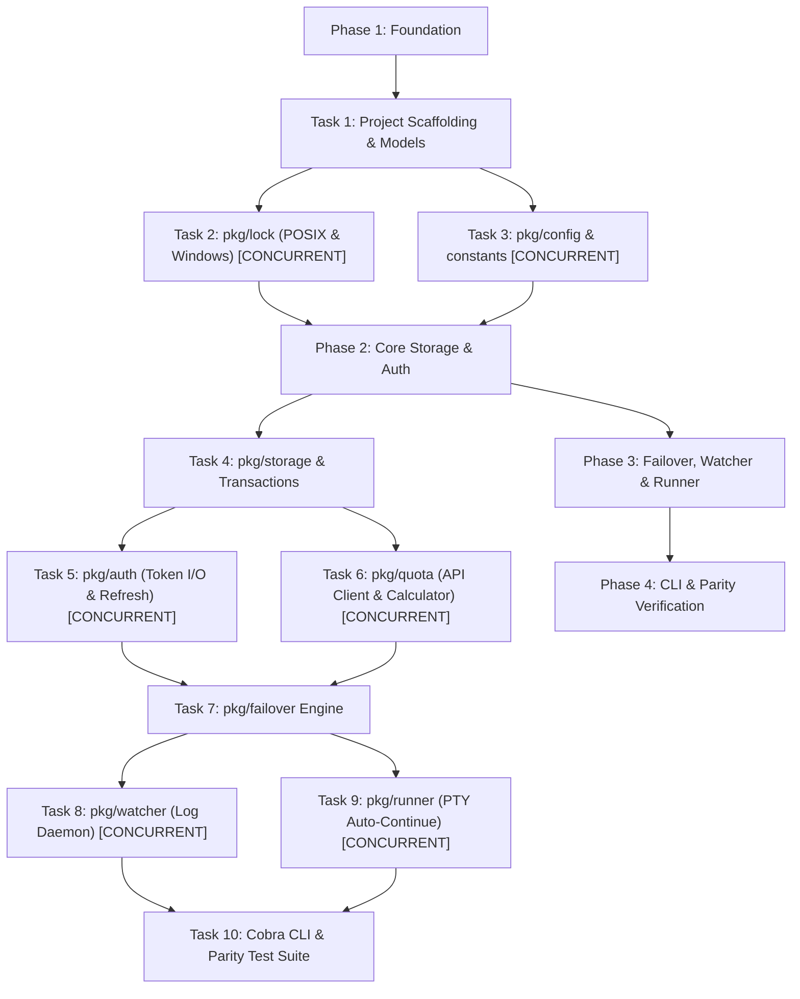

# Promux Go Refactor: Architecture & Design Specification

> **Document:** Design Specification  
> **Status:** Draft / Ready for Review  
> **Target Branch:** `feat/go-core`  
> **Date:** 2026-10-16  
> **Version Target:** 1.0.0 (Go Native)  

---

## 1. Executive Summary & Objectives

Promux is currently a zero-runtime-dependency Python CLI tool and daemon (~4,500 LOC core, ~6,300 LOC tests across 281 tests). While structurally clean and battle-tested, Python introduces installation barriers for non-Python developers (`pipx`, Python 3.10+ requirement), startup latency (~50ms), and difficulties packaging native terminal UIs or single-binary distributions.

### Primary Objectives:
1. **Single Static Binary Distribution:** Compile into a standalone ~10MB binary with zero runtime dependencies on Linux, macOS, and Windows.
2. **100% Vault Compatibility:** Existing `~/.promux` configurations, account tokens, and `state.json` files must work without migration or data loss.
3. **1:1 Behavioral Parity:** Replicate all core commands (`profile`, `quota`, `watch`, `tools`, `version`, `completion`) and pass equivalent test suites.
4. **Autonomous PTY Runner (`promux run`):** Solve the unassisted overnight agent stall by wrapping CLI processes in a pseudo-terminal (PTY) and automatically injecting `continue\n` after a 429 quota hot-swap.
5. **Sub-5ms Startup Latency:** Enable instantaneous shell prompt integrations (e.g. Starship).

---

## 2. System Architecture & Package Layout

```
promux/
├── cmd/
│   └── promux/
│       └── main.go                 # Entrypoint
├── pkg/
│   ├── config/                     # Paths, environment variables, defaults
│   │   ├── paths.go
│   │   └── constants.go
│   ├── models/                     # Core domain structs (AccountMeta, QuotaSummary, etc.)
│   │   ├── account.go
│   │   └── quota.go
│   ├── lock/                       # Cross-platform advisory file lock (POSIX + Windows)
│   │   ├── lock.go
│   │   ├── lock_unix.go
│   │   └── lock_windows.go
│   ├── storage/                    # Vault storage engine & atomic JSON transactions
│   │   ├── storage.go
│   │   └── transaction.go
│   ├── auth/                       # OAuth token decoding, expiry checks, token refresh
│   │   ├── token.go
│   │   └── refresh.go
│   ├── quota/                      # Google Cloud Code Assist REST API client & cache
│   │   ├── client.go
│   │   ├── calculator.go
│   │   └── cache.go
│   ├── failover/                   # Profile rotation engine (next / smart rotation)
│   │   ├── engine.go
│   │   └── strategy.go
│   ├── watcher/                    # Passive log tailing daemon (cli.log / log/*.log)
│   │   ├── watcher.go
│   │   └── parser.go
│   ├── runner/                     # Autonomous PTY wrapper with auto-continue injection
│   │   ├── runner.go
│   │   └── pty.go
│   ├── adapter/                    # Multi-tool adapter registry (agy, claude, codex, cursor)
│   │   ├── adapter.go
│   │   ├── registry.go
│   │   └── agy.go
│   └── cmd/                        # Cobra command hierarchy
│       ├── root.go
│       ├── profile.go
│       ├── quota.go
│       ├── watch.go
│       ├── run.go
│       └── tools.go
├── go.mod
├── go.sum
└── Makefile
```

---

## 3. Key Subsystems Design

### 3.1 Cross-Platform Advisory File Locking (`pkg/lock`)
* **POSIX:** `golang.org/x/sys/unix` with `fcntl.Flock` (`LOCK_EX`, `LOCK_UN`, non-blocking `LOCK_NB`).
* **Windows:** Syscall `LockFileEx` / `UnlockFileEx` on the underlying `os.File` handle.
* **Interface:**
  ```go
  type Locker interface {
      Lock() error
      TryLock() (bool, error)
      Unlock() error
  }
  func NewFileLock(path string) Locker
  ```

### 3.2 Storage Engine & Atomic Vaulting (`pkg/storage`)
* **State File:** `~/.promux/tools/<tool>/state.json`.
* **Atomic Writes:** Data is written to `state.json.tmp` with `0600` permissions and committed via `os.Rename`.
* **Transactions:**
  ```go
  func (s *StorageEngine) Transaction(ctx context.Context, fn func(state *models.State) error) error
  ```
  Acquires `manager.lock`, loads `state.json`, executes mutator `fn`, writes atomically, and unlocks in `defer`.

### 3.3 Google Cloud Code Assist Quota Client (`pkg/quota`)
* **Endpoints:**
  * User Info & Project: `https://daily-cloudcode-pa.googleapis.com/v1internal:loadCodeAssist`
  * Quota / Models: `https://daily-cloudcode-pa.googleapis.com/v1internal:fetchAvailableModels`
* **Calculations:**
  * 5-hour rolling window percentage & reset countdown.
  * 7-day weekly window percentage & reset countdown.
* **Caching:** In-memory + disk cache in `~/.promux/tools/agy/cache/` guarded by file lock.

### 3.4 Autonomous PTY Runner (`pkg/runner`)
* **Library:** `github.com/creack/pty`.
* **Mechanism:**
  1. Starts target command (`agy`) inside a pseudo-terminal.
  2. Put host terminal into raw mode and proxy stdin/stdout/stderr seamlessly.
  3. Tees the stdout stream into an in-memory buffer matching regexes:
     * `INDIVIDUAL_QUOTA_RE`
     * `RESOURCE_EXHAUSTED_RE`
     * `WEEKLY_QUOTA_RE`
  4. When a match occurs:
     * Triggers `FailoverEngine.RotateNext()` (swapping `antigravity-oauth-token` under lock).
     * Waits 250ms for process to settle at input prompt.
     * Injects `continue\r\n` into the child PTY's `stdin`.
     * Logs the auto-continuation event.

### 3.5 CLI Framework (`pkg/cmd`)
* Built with **`github.com/spf13/cobra`** for subcommands and **`github.com/spf13/pflag`** for POSIX flags.
* Grammar compatibility:
  * `promux [tool] profile <subcommand>`
  * `promux [tool] quota [inspect|refresh|list]`
  * `promux [tool] watch [start|stop|status]`
  * `promux run <tool> [args...]`
  * Transparent top-level defaults (omitting `<tool>` defaults to `agy`).

---

## 4. Dependencies Strategy

To maintain high security and performance, third-party dependencies are strictly minimized:
1. `github.com/spf13/cobra` — Industry standard CLI dispatcher.
2. `github.com/creack/pty` — Cross-platform PTY allocation for `promux run`.
3. `golang.org/x/sys` — Direct OS syscalls for locks, terminals, and signals.
4. `github.com/fatih/color` or `github.com/charmbracelet/lipgloss` — Clean terminal styling.

---

## 5. Parity Testing & Quality Assurance

The Go implementation must replicate the test coverage of the existing 281 Python tests:
* **Unit Tests (`*_test.go`):** Table-driven tests for quota parsing, reset duration calculations, state transactions, and lock behaviors.
* **Concurrency Tests:** Race detector enabled (`go test -race ./...`) testing simultaneous profile rotations and file lock contention.
* **Mock API Server:** Local HTTP mock server simulating Google Cloud Code Assist responses (including HTTP 429 and rate-limit headers).
* **CLI Golden Tests:** Testing standard output formats (plain text, JSON, colorized) against Python baseline fixtures.

---

## 6. Execution Plan & Subagent Task Breakdown

The refactor will be executed in **4 phases across 10 discrete tasks**. Tasks marked **[CONCURRENT]** can be executed in parallel using subagents:



### Dependency Map:
* **Task 1:** Scaffolding (`go.mod`, directory structure)
* **Task 2 & 3 (Parallel Subagents):** `pkg/lock` and `pkg/config`
* **Task 4:** `pkg/storage` (requires 1, 2, 3)
* **Task 5 & 6 (Parallel Subagents):** `pkg/auth` and `pkg/quota`
* **Task 7:** `pkg/failover` (requires 4, 5, 6)
* **Task 8 & 9 (Parallel Subagents):** `pkg/watcher` and `pkg/runner` (PTY wrapper)
* **Task 10:** Cobra commands & complete parity test validation
